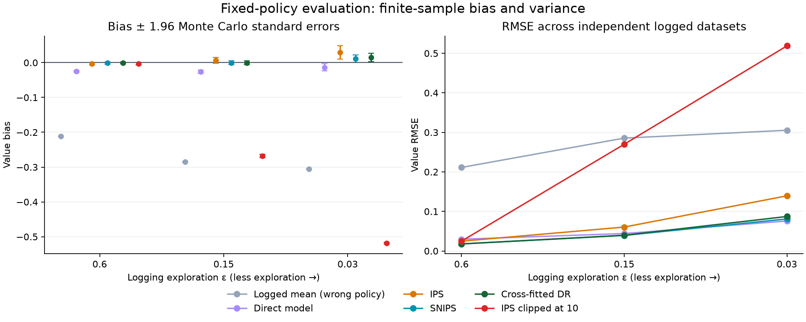
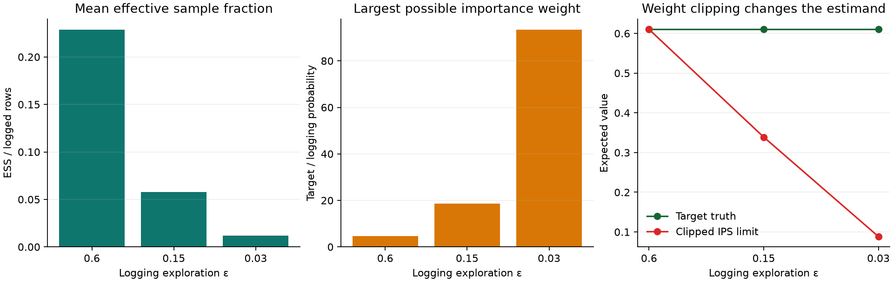

# Logged Bandit Policy Evaluation Lab

[](https://github.com/lcx0731/logged-bandit-policy-evaluation-lab/actions/workflows/tests.yml)

Can a fixed new decision policy be evaluated from rewards collected by a different
policy? This small project compares six estimators in a three-action contextual
bandit, with **exact population truth**, explicit support checks, and a controlled
stress test of logging exploration.

The implementation focuses on policy value and logging coverage. It does not
estimate a binary-treatment average effect, optimize a trading strategy, or
implement an interference-aware research paper. All observations are synthetic.

## Run locally

Python 3.11 or newer:

```bash
python3 -m venv .venv
source .venv/bin/activate
python -m pip install -e '.[test]'
python -m pytest -W error
python -m bandit_audit --repetitions 200 --size 3000 --seed 20261001 --output artifacts
```

The committed run used Python 3.13, NumPy 2.5.3, and Matplotlib 3.11.2.
On Python 3.13, use `python -m pip install -c constraints-python313.txt -e '.[test]'`
to select the tested dependency versions. Other supported Python versions use
the compatible bounds in `pyproject.toml`; floating-point and plotting differences
across versions/platforms are possible.

## Design

There are eight context values evenly spaced on [-1, 1], with probabilities
`[.06, .10, .14, .20, .20, .14, .10, .06]`, and three actions. Reward means are
`0.30 + 0.15*x`, `0.35 + 0.35*(1-x²)`, and `0.50 + 0.25*sin(pi*x)`.
Observed rewards are Bernoulli draws for the chosen action only.

The target policy is fixed before any logs are sampled: 90% of its probability
goes to action 1 for negative contexts and action 2 for positive contexts; the
remaining 10% is uniform over all actions. This is a prespecified policy, not an
oracle-selected or learned policy. Its exact value is obtained by summing the
known conditional reward means across all 24 context-action cells.

The logger assigns probability `1-ε` to action 0, plus uniform exploration `ε`.
We use ε = 0.60, 0.15, and 0.03, each with 200 independent logs of 3,000 rows.
Correct logging probabilities are retained with every row. An ε = 0 negative
control is explicitly rejected: target actions have no logging support.

## Estimators

Write `w = π(a|x)/μ(a|x)` for the target-to-logging probability ratio, and
`b(x) = sum_a π(a|x) q_hat(x,a)` for the model-based target reward.

| Estimator | Sample formula | Main caveat |
| --- | --- | --- |
| Logged mean | `mean(r)` | Evaluates the logging policy, not the target |
| Direct | `mean(b(x))` | Relies on the reward model |
| IPS | `mean(w*r)` | Can have high variance with weak coverage |
| SNIPS | `sum(w*r)/sum(w)` | Self-normalization introduces finite-sample bias |
| Cross-fitted DR | `mean(b(x) + w*(r-q_hat(x,a)))` | Still sensitive to large residual weights |
| Clipped IPS | `mean(min(w,10)*r)` | Reduces weights at the cost of changing the estimand |

The direct and DR estimators share the same out-of-fold reward predictions.
Each action gets a ridge regression with an intercept and linear context term,
then predictions are clipped to [0, 1]. The nonlinear reward surfaces are
deliberately misspecified. Three balanced random folds are assigned independently
of outcomes and actions. A held-out row never trains its own predictor.

With correct propensities and support, IPS targets the policy value. DR's residual
correction also targets it when its reward model is independent of the evaluated
row, even if that model is wrong. General double-robust consistency requires
appropriate identification and nuisance-estimation conditions; this experiment
tests the **known-propensity** case only.

## Validated default-run results

The exact target value is **0.610183**. Each row below summarizes 200 independent
logs of 3,000 observations at the fixed seed above; lower RMSE is better.

| Exploration ε | Mean weight ESS | Direct RMSE | IPS RMSE | SNIPS RMSE | DR RMSE |
| --- | ---: | ---: | ---: | ---: | ---: |
| 0.60 | 685.6 | 0.0297 | 0.0247 | 0.0178 | 0.0178 |
| 0.15 | 173.7 | 0.0441 | 0.0605 | 0.0393 | 0.0398 |
| 0.03 | 35.3 | 0.0758 | 0.1394 | 0.0810 | 0.0872 |

Weak coverage matters more than the nominal row count: 3,000 logged observations
produce a mean importance-weight ESS of only 35.3 in the least exploratory case.
DR improves on IPS RMSE in this experiment, but SNIPS is slightly better than DR,
and the biased direct model has the lowest RMSE under the weakest coverage.
There is no universal winner in this finite-sample comparison.

The observed IPS bias at ε = 0.03 is +0.0292 with Monte Carlo SE 0.0097. This
finite set of replications does not yield a zero observed bias, despite the exact
IPS expectation identity verified by the enumerated-world test. Treat simulation
rankings and empirical intervals as estimates, particularly with rare large weights.

Clipping at 10 changes the exact limiting value from 0.610183 to 0.338883
at ε = 0.15 and to 0.088453 at ε = 0.03. The observed means are 0.342249 and
0.091609 respectively: smaller weights alone do not repair weak logging coverage.
The zero-exploration negative control rejects 16 unsupported context-action cells.





## Outputs and interpretation

- `artifacts/summary.json`: exact truth, bias, Monte Carlo standard errors, RMSE,
  central 90% empirical ranges, and weight diagnostics.
- `artifacts/replications.json`: all 600 run-level estimates and diagnostics.
- `artifacts/estimator_audit.png`: bias uncertainty and RMSE.
- `artifacts/support_diagnostics.png`: effective sample fraction, maximum weight,
  and the exact shifted estimand created by clipping.

The exact clipped estimand is computed as
`sum_x,a p(x)*μ(a|x)*min(π(a|x)/μ(a|x),10)*q(x,a)`.
Weight diagnostics concern the original weights; they are not sample-size
guarantees. Monte Carlo error bars quantify uncertainty in the estimated **bias**,
not a deployment confidence interval. No estimate is silently clipped to [0, 1].

## Limitations

- IID, one-step, stationary bandits; no sequential state dynamics or interference.
- Logging probabilities are known exactly, not estimated or corrupted.
- Small, discrete synthetic world; no real-world policy improvement claim.
- No policy selection on the evaluation data, confidence intervals for deployment,
  multiple-policy selection correction, or reward drift.
- Support is checked over the full known synthetic context universe. For external
  logs, observed rows alone cannot certify support in unobserved contexts.
- Very small logs can leave too few action observations in a training fold; the
  code fails explicitly rather than fabricating predictions or dropping trials.

## Tests and implementation

The package separates policies/sampling, estimators, cross-fitting, and experiment
reporting. Tests cover hand-calculated values, exact expectation identities,
unsupported policies, malformed propensities, and held-out reward isolation.
GitHub Actions tests Python 3.11 and 3.13 and runs the CLI on each.

## Method reference

Dudík, Langford, and Li (2011),
[Doubly Robust Policy Evaluation and Learning](https://arxiv.org/abs/1103.4601).
This is an original compact implementation of standard estimators, not copied
code or a reproduction of that paper's experiments. The data generator is fully
specified here and in `src/bandit_audit/policies.py`; no external dataset is used.

Educational portfolio project. Not investment advice or a production decision
system. MIT licensed.
